<div align="center">

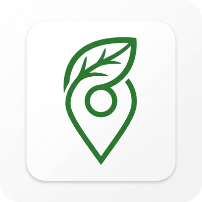

# BizForest

### Geospatial AI platform for urban reforestation planning in Bizerte, Tunisia

Satellite imagery + machine learning + a web map + a mobile app, used to find **where trees were lost**, **where land is ready for planting**, and **which zones need action first**.


<br>


&nbsp;&nbsp;&nbsp;&nbsp;

&nbsp;&nbsp;&nbsp;&nbsp;


</div>

---

## Table of contents

- [Why this project](#why-this-project)
- [How it works](#how-it-works)
- [The website](#the-website)
- [The mobile app](#the-mobile-app)
- [User roles](#user-roles)
- [Data and methodology](#data-and-methodology)
- [Tech stack](#tech-stack)
- [Repository structure](#repository-structure)
- [Getting started](#getting-started)
- [Credits](#credits)

---

## Why this project

The **Bizerte Governorate** in northern Tunisia combines dense cities (Bizerte, Zarzouna, Menzel Bourguiba), fragile natural ecosystems (Lake Ichkeul, cork oak forests) and farmland under growing urban pressure.

- The Hansen Global Forest Change data shows about **14,200 hectares of forest lost since 2000**.
- Urban heat islands, measured with Landsat-9 land surface temperature, make tree planting a **public health and ecological priority**.
- Field teams, managers and authorities had no single tool showing **where** to plant and **what** has already been done.

**BizForest** answers that need. It turns satellite analysis into a map anyone can open in a browser, plus a mobile app that field teams use on the ground to survey zones, log plantings and report incidents. All of it syncs to the same cloud database.

> **Mission:** identify, prioritize and help coordinate reforestation across Bizerte's **383,000 hectares**, using Sentinel-2 imagery, a Random Forest classifier and a multi-criteria priority model, all accessible from a browser or a smartphone.

---

## How it works

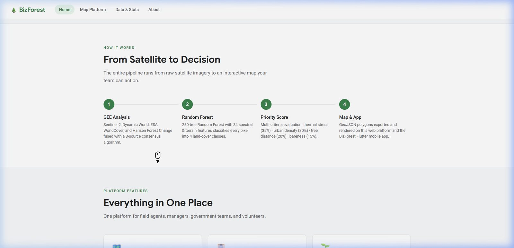

The pipeline goes from raw satellite images to decisions on the ground:

```
 ┌────────────────────┐   ┌────────────────────┐   ┌────────────────────┐   ┌────────────────────┐
 │ 1. GEE analysis    │──▶│ 2. Random Forest   │──▶│ 3. Priority score  │──▶│ 4. Map & app       │
 │ Sentinel-2,        │   │ 250 trees,         │   │ Multi-criteria     │   │ GeoJSON layers on  │
 │ Dynamic World,     │   │ 34 spectral and    │   │ evaluation (MCE)   │   │ the website and    │
 │ ESA WorldCover,    │   │ terrain features,  │   │ gives every zone   │   │ the Flutter app,   │
 │ Hansen Forest      │   │ 4 land-cover       │   │ a 0–1 score        │   │ field data synced  │
 │ Change             │   │ classes            │   │                    │   │ to Firestore       │
 └────────────────────┘   └────────────────────┘   └────────────────────┘   └────────────────────┘
```

1. **Google Earth Engine analysis:** Sentinel-2 (spring 2024 median composite), Dynamic World, ESA WorldCover and Hansen Forest Change are fused with a 3-source consensus algorithm.
2. **Random Forest classification:** a 250-tree model using 34 spectral and terrain features (NDVI, EVI, MNDWI, BSI, GLCM texture, …) puts every 10 m pixel into one of 4 land-cover classes.
3. **Priority scoring:** a multi-criteria evaluation ranks candidate land:

   | Criterion | Weight | Source |
   | --- | --- | --- |
   | Thermal stress (land surface temperature) | **35 %** | Landsat-9 |
   | Urban density | **30 %** | Sentinel-2 NDBI + UI |
   | Distance to existing trees | **20 %** | Random Forest tree cover |
   | Bareness (inverse NDVI) | **15 %** | Sentinel-2 NDVI |

4. **Delivery:** results are exported as GeoJSON polygons. The **website** shows them on an interactive Leaflet map. The **mobile app** shows the same layers and lets field teams send surveys, plantings and incidents to **Firebase Firestore**.

---

## The website

A static website (HTML, CSS, JavaScript and Leaflet) with four pages. It needs no backend and can be hosted anywhere, including GitHub Pages.

### Home page
Gives an overview of the project with key figures: **383k ha mapped**, **10 m resolution**, **14.2k ha deforested** and **84 priority zones**.

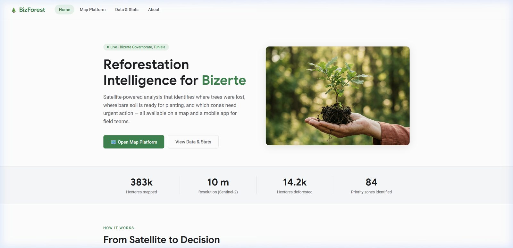

### Platform features
Explains what the platform offers each type of user.

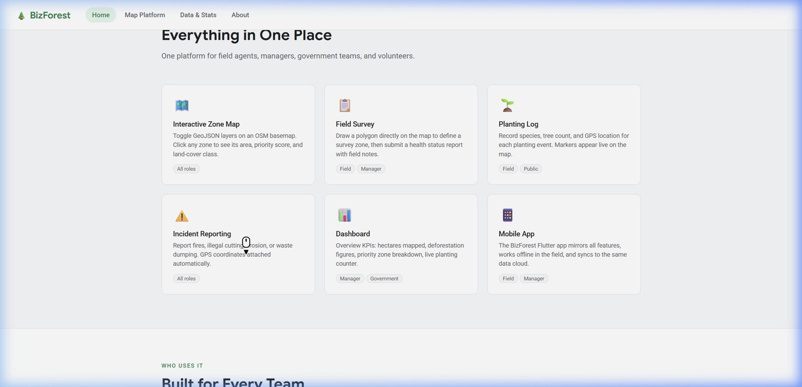

### Interactive map platform
The main tool. You can switch these layers on and off:
- **Priority zones:** very high, high, and all zones
- **Vegetation and land:** existing tree cover and candidate land
- **Study area:** the Bizerte boundary
- **Basemap:** street, satellite or topographic

Click any zone to see its area, priority score and land-cover class.

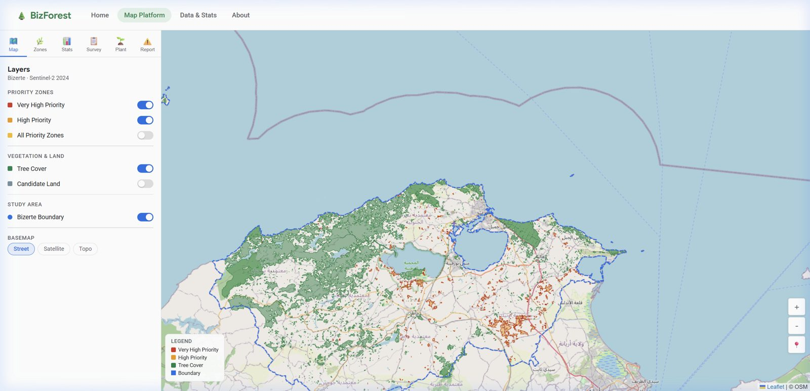

### Data and statistics
Shows the priority breakdown (12 very high, 28 high, 24 moderate and 20 low zones), the weights of the multi-criteria model, and the spectral indices used.

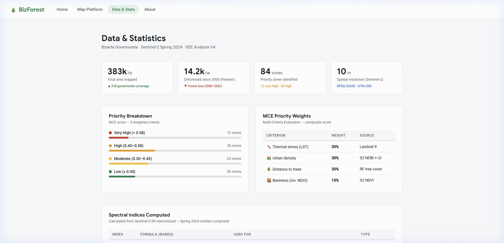

### About
Describes the project's mission, why it focuses on Bizerte, and its three components: satellite analysis, web platform and mobile app.

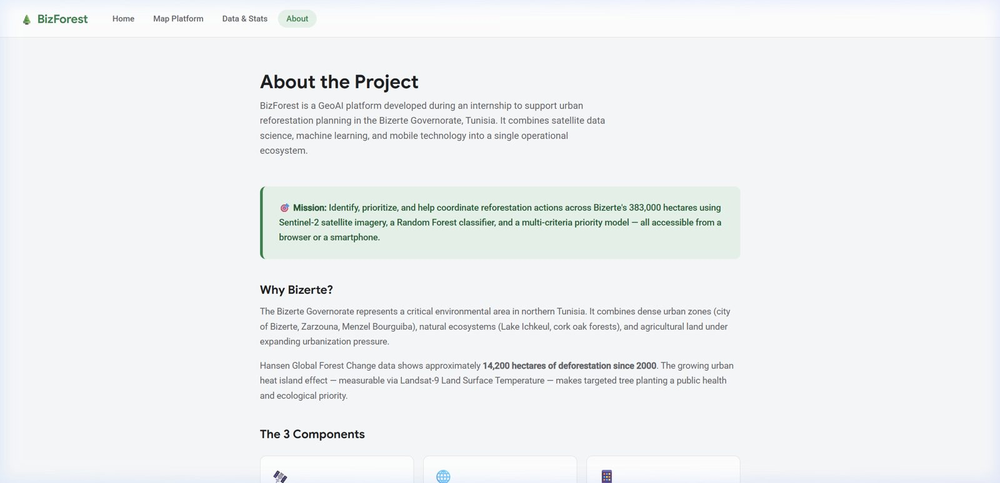

---

## The mobile app

**BizForest** for Android and iOS is built with Flutter. It is the field companion to the website: it shows the same map layers and adds data collection with GPS, photos and cloud sync.

<table>
  <tr>
    <td align="center" width="25%">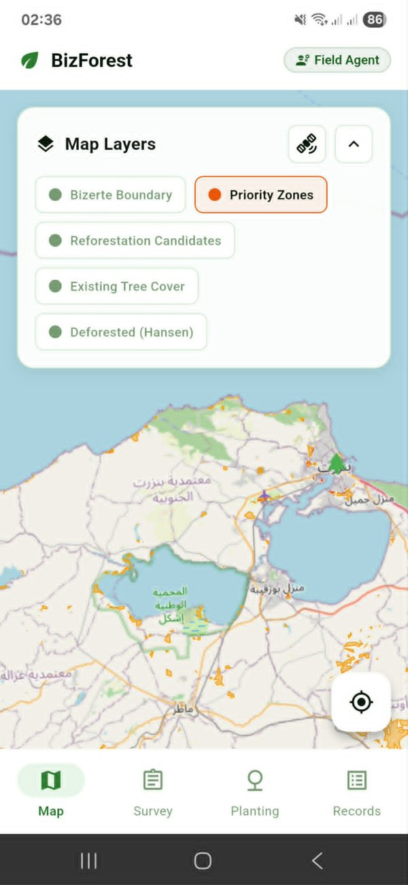<br><b>Map</b></td>
    <td align="center" width="25%">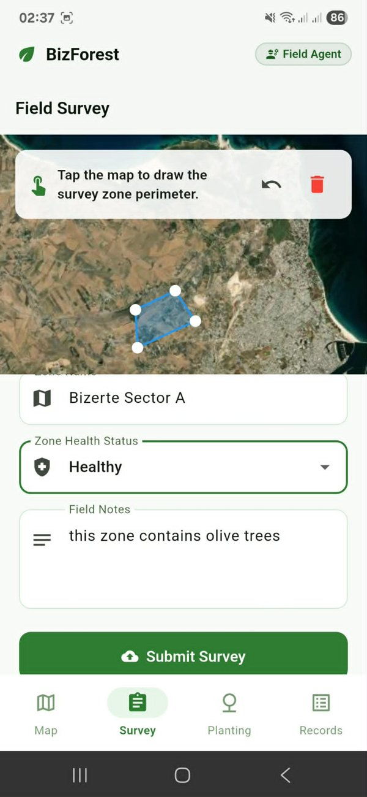<br><b>Field survey</b></td>
    <td align="center" width="25%">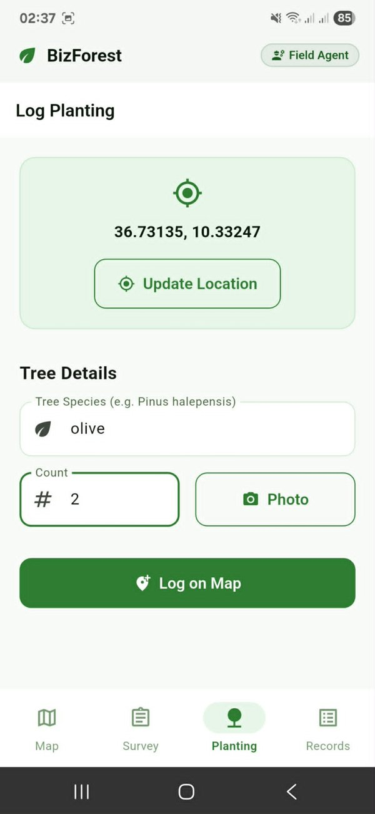<br><b>Log planting</b></td>
    <td align="center" width="25%">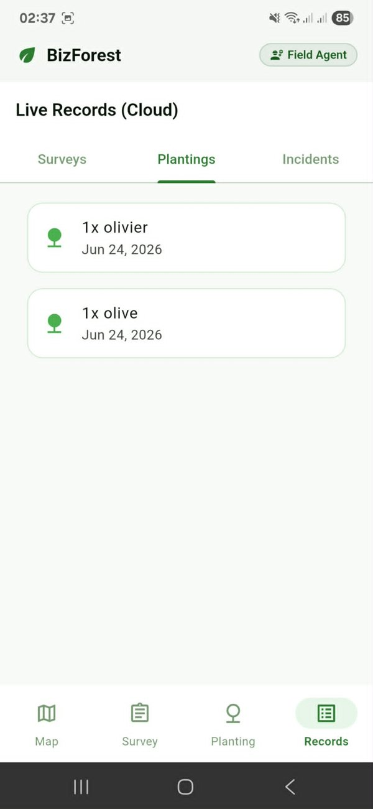<br><b>Live records</b></td>
  </tr>
</table>

| Screen | What it does |
| --- | --- |
| **Map** | Shows the Bizerte boundary, priority zones, reforestation candidates, existing tree cover and Hansen deforestation on OpenStreetMap or satellite imagery. A GPS button centers the map on your position, and tapping a planted tree marker shows its details. |
| **Field survey** | Tap the map to draw the perimeter of a survey zone, give it a name, set its health status and add field notes, then submit. |
| **Log planting** | Records the GPS position, tree species, number of trees and an optional photo. The planting then appears as a marker on the map. |
| **Incidents** | Reports fires, illegal cutting, erosion or waste dumping. GPS coordinates are attached automatically. |
| **Records (cloud)** | Shows live lists of surveys, plantings and incidents synced from Firestore, as tabs. |
| **Dashboard** | Shows key figures: hectares mapped, deforestation, priority zones and live planting counts. |
| **Field assistant** | Answers GIS and field-work questions. It works **offline** with built-in guidance and can optionally use an LLM through OpenRouter with your own API key. |

On first launch, an **onboarding screen** asks the user to choose a role. The app then shows only the screens that role needs.

---

## User roles

| Role | Who | Screens in the app |
| --- | --- | --- |
| 🧑‍🌾 **Field Agent** | Forestry teams in the field | Map · Survey · Planting · Records |
| 📊 **Manager** | Project coordinators | Dashboard · Map · Records |
| 🏛️ **Government** | Local authorities and decision makers | Dashboard · Map |
| 🙋 **Volunteer** | Citizens and NGOs | Map · Planting · Incidents |

---

## Data and methodology

| Item | Value |
| --- | --- |
| Study area | Bizerte Governorate, Tunisia (~383,000 ha) |
| Imagery | Sentinel-2 SR Harmonized, spring 2024 median composite |
| Resolution | 10 m |
| Projection | EPSG:32632 (UTM 32N) |
| Classifier | Random Forest, 250 trees, 34 features, 4 classes |
| Indices | NDVI, EVI, MNDWI, NDWI, NDBI, BSI, GLCM texture |
| Deforestation reference | Hansen Global Forest Change, 2000–2023 |
| Heat | Landsat-9 land surface temperature |
| Output layers | `bizerte_boundary`, `bizerte_priority_zones`, `bizerte_reforestation_candidates`, `bizerte_tree_cover`, `bizerte_deforested_areas_hansen` (GeoJSON) |

Tree cover is defined as NDVI > 0.3 and EVI > 0.2. Water is detected with MNDWI, NDWI, near-infrared reflectance and Dynamic World, then buffered by 60 m. Both tree cover and water are excluded from the candidate land.

---

## Tech stack

| Layer | Technologies |
| --- | --- |
| Remote sensing and machine learning | Google Earth Engine, Sentinel-2, Landsat-9, Random Forest, QGIS |
| Website | HTML5, CSS3, JavaScript, Leaflet 1.9.4, OpenStreetMap / Esri / OpenTopoMap tiles |
| Mobile app | Flutter (Dart), `flutter_map`, `geolocator`, `image_picker`, `flutter_animate`, `shared_preferences` |
| Cloud | Firebase Core and Cloud Firestore (`field_surveys`, `plantings` and `incidents` collections) |
| Field assistant | Offline rule-based guidance, plus optional OpenRouter LLM |

---

## Repository structure

```
BizForest/
├── bizerte_reforest_agent/      # Flutter mobile app
│   ├── lib/
│   │   ├── main.dart            # App entry point and role-based navigation
│   │   ├── models.dart          # Roles, records, plantings, incidents, chat messages
│   │   ├── theme.dart
│   │   ├── firebase_options.dart
│   │   ├── screens/             # map, survey, planting, incidents, records, dashboard, agent, onboarding
│   │   └── services/            # cloud (Firestore), GeoJSON, local storage, assistant
│   ├── assets/geojson/          # GIS layers shown in the app
│   ├── android/  ios/           # Native platform projects
│   └── pubspec.yaml
├── bizforest_website/           # Static website
│   ├── index.html               # Home
│   ├── map.html                 # Interactive Leaflet map
│   ├── data.html                # Data and statistics
│   ├── about.html               # About the project
│   └── assets/                  # CSS, hero image, GeoJSON layers
└── docs/                        # README screenshots and logos
```

---

## Getting started

### Mobile app

You need the [Flutter SDK](https://docs.flutter.dev/get-started/install) (Dart 3.3 or newer), and Android Studio or Xcode.

> [!IMPORTANT]
> **Use your own Firebase project.** This repository does not include any Firebase keys. To use cloud sync, create your own free Firebase project and add its settings.

1. Go to the [Firebase Console](https://console.firebase.google.com), create a project and enable **Cloud Firestore**.
2. In **Project settings → General → Your apps**, add a **Web app** and copy its config values (`apiKey`, `appId`, `projectId`, …).
3. Create your local config file and paste your values into it:

```bash
cd bizerte_reforest_agent
cp firebase_config.example.json firebase_config.json
```

`firebase_config.json` is gitignored, so your keys are never uploaded.

Then build and run:

```bash
flutter pub get
flutter run --dart-define-from-file=firebase_config.json          # on a device or emulator
flutter build apk --dart-define-from-file=firebase_config.json    # build an Android APK
```

In VS Code, press **F5**: the included `.vscode/launch.json` passes the config automatically. Without a config, the app still runs, but cloud sync is turned off.

- GPS, camera and internet permissions are described in [`NATIVE_SETUP.md`](bizerte_reforest_agent/NATIVE_SETUP.md).
- **Optional field assistant:** open the Agent screen, paste an [OpenRouter](https://openrouter.ai) API key and choose a model. Without a key, the assistant uses its offline guide.

### Website

The map loads its GeoJSON files with `fetch`, so serve the folder over HTTP instead of opening the HTML file directly:

```bash
cd bizforest_website
python -m http.server 8000
# then open http://localhost:8000
```

To host the site with **GitHub Pages**, publish the `bizforest_website/` folder (for example with a GitHub Actions Pages workflow, or by copying it to a `gh-pages` branch).

---

## Credits

**Created by Mohamed Zouari** during an internship, academic year 2025/2026.

- **Host organization:** AGI – Association of Geospatial Intelligence (Tunisia)
- **Supervisor:** Mrs. Hajer Guenichi (AGI)
- **Academic institution:** MSE – Manouba School of Engineering, University of Manouba

Data sources: Copernicus Sentinel-2 (ESA), Landsat-9 (USGS/NASA), Hansen Global Forest Change (University of Maryland), Google Dynamic World, ESA WorldCover and OpenStreetMap contributors.
